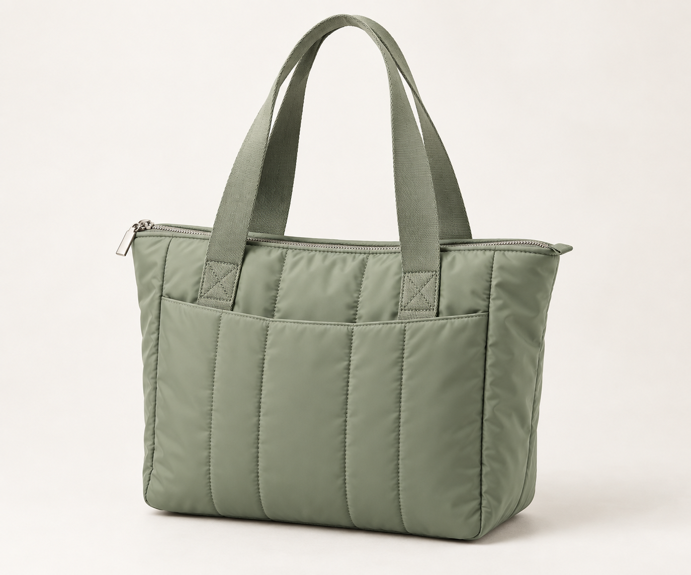

# ShopMind · AI 商品创意导演

> 参赛作品 · **天猫 AI 黑客松高校挑战赛**（主题：开造未来，让 AI 成真）
>
> 🔗 在线展示页：<https://halou02.github.io/shopmind-demo/>

把一个商品的本地资料（商品信息、评价、历史内容、品牌规则、商品图片），自动变成一套**可直接使用的多平台营销创意包**：商品理解卡 → 创意方向 → 抖音 / 快手 / 小红书 / 淘宝详情 / 视频脚本 / 视觉提示词，并导出为结构化内容包。

一切基于**本地资料**运行，默认离线可用，不依赖外部市场数据 —— 明确声明能力边界，不编造用户反馈与市场结论。

---

## 亮点

- **创意五步流水线**：录入 → 理解 → 方向 → 生成 → 导出，全过程可视化、可回溯。
- **证据可溯源**：每个创意方向都绑定 `evidence`（评价洞察）与 `asset`（图片素材），避免"拍脑袋"式文案。
- **多平台一次成稿**：一次生成抖音、快手、小红书、视频、视觉、详情页六个渠道的内容。
- **本地优先 / 隐私可控**：素材与生成结果都保存在本地 `workspace/`，不强制上云；AI 能力（文本 / 视觉 / 图片 / 视频）可分别在网页「AI 设置」中配置。
- **结构化交付**：导出标准内容包（`manifest.json` + `contentpackage` + `content/*.md`），带 SHA256 校验，便于审阅与二次集成。
- **零基础可跑**：双击两个 `.bat` 文件即可在 Windows 上启动，自动创建虚拟环境并安装依赖。



---

## 创意五步

| 步骤 | 说明 | 对应模块 |
| --- | --- | --- |
| 1. 录入 | 上传商品资料 / 图片，或选取素材库 | `app/web/materials_flow.py` |
| 2. 理解 | 扫描来源、抽取证据、生成商品理解卡与经营判断 | `app/core/product_understanding.py`、`app/core/business_judgment.py` |
| 3. 方向 | 生成多个带证据的创意方向并选定 | `app/core/creative_directions.py` |
| 4. 生成 | 生成多平台文案、视频脚本、视觉提示词与配图 | `app/core/content_generator.py`、`app/core/ai_media_generator.py` |
| 5. 导出 | 打包为内容包（含清单与校验） | `app/export/content_package.py` |

---

## 快速开始（Windows）

1. 双击 **`首次安装.bat`**（或 `install.bat`）：检测 Python（3.11+）、创建 `.venv`、安装依赖。
2. 双击 **`启动网站.bat`**（或 `start.bat`）：启动服务并自动打开浏览器。首次运行会自动完成安装。
3. 访问 **http://127.0.0.1:8080**。

> 若解压后中文文件名变成乱码，直接用英文名的 `install.bat` / `start.bat` 即可。
> 必须先把压缩包完整解压，不要在压缩包预览窗口里直接双击运行。

### 配置 AI（可选）

在项目根的 `.env` 中填入，或启动后在网页右上角「AI 设置」里填写：

```
DASHSCOPE_API_KEY=你的百炼 API Key
AIPC_LLM_BASE_URL=https://dashscope.aliyuncs.com/compatible-mode/v1
AIPC_LLM_MODEL=qwen-plus
```

未配置 Key 时，流水线仍可基于本地资料生成**离线演示内容包**。

---

## 技术栈

- **后端**：Python 3.11+ · FastAPI · Uvicorn（[`app/web/server.py`](app/web/server.py)）
- **前端**：原生 HTML / CSS / JS（[`app/web/static/`](app/web/static/)）
- **AI**：OpenAI 兼容接口（默认阿里云百炼 Qwen 系列），也支持本地 Ollama 视觉模型
- **测试**：pytest（[`dev/tests/`](dev/tests/)，40+ 用例）

---

## 目录结构

```
app/
  core/      业务核心：理解、判断、方向、内容、AI 调用
  steps/     创意五步流水线
  web/       FastAPI 服务与网页前端（static/）
  export/    内容包导出与清单校验
dev/
  tests/     测试用例
  deploy/    部署脚本（nginx / systemd）
assets/
  demo_packs/  演示素材包（牛仔裤 / 通勤包）
workspace/     运行数据：上传、素材库、生成结果、导出包
```

---

## 演示数据

仓库内 `assets/demo_packs/` 与 `workspace/` 为**比赛演示数据**（示例商品、生成的创意包），用于展示成品效果。

> 说明：品牌、商品参数、评价和历史内容均为比赛演示数据，**不代表真实用户反馈或真实经营表现**。

---

## 边界声明

- 仅基于**本地资料**生成
- **未接入**市场、利润、广告与实时竞品数据，**不作相关判断**
- 演示素材与生成内容仅供比赛 Demo 使用

---

## 许可

仅用于天猫 AI 黑客松比赛演示用途。
